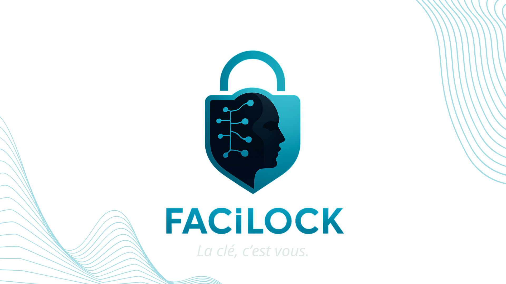
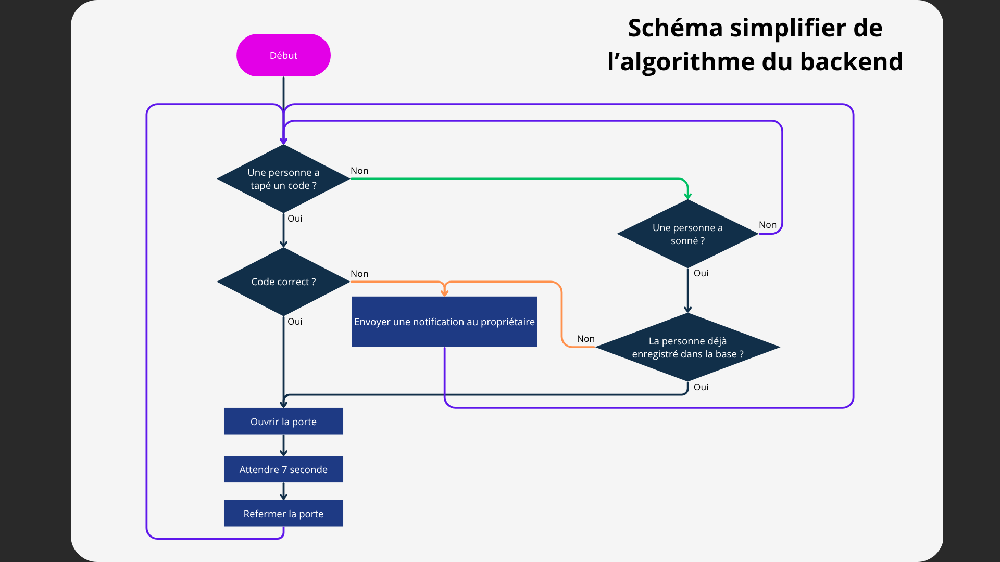
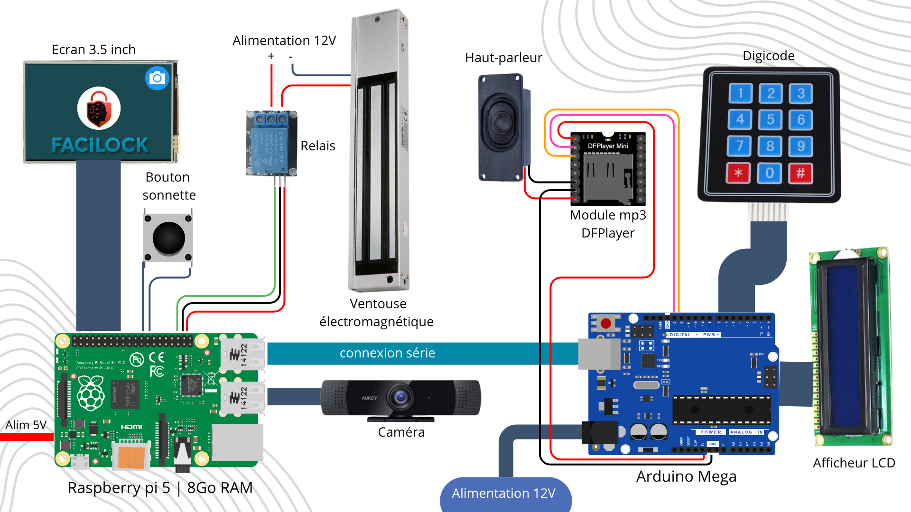
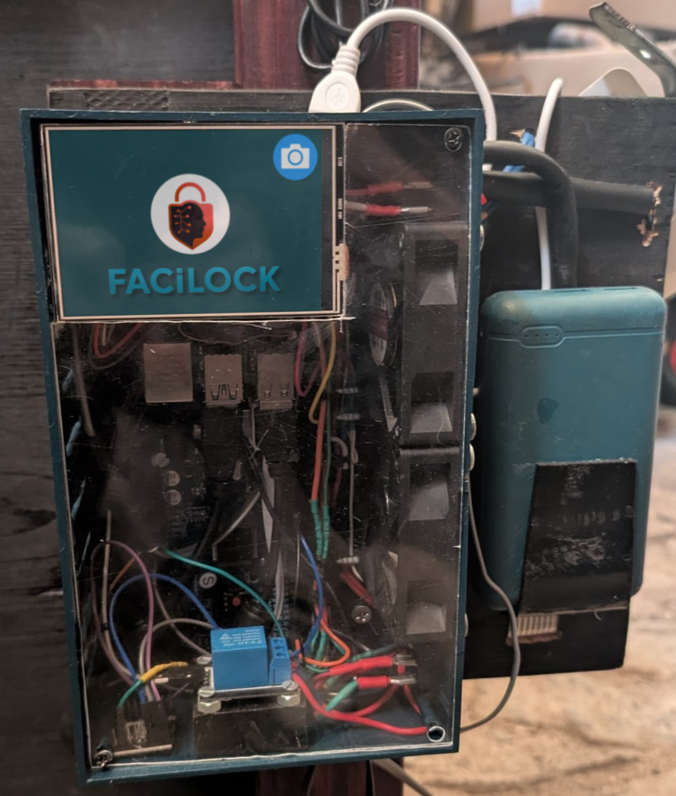

<p align="center">
  <b>Français</b> | <a href="README_en.md">English</a>
</p>

# FaciLock

<p align="center">
  
</p>

Serrure connectée à reconnaissance faciale, construite autour d'un Raspberry Pi 5, d'un Arduino (digicode, écran LCD, son) et d'une application mobile React Native.

> [!NOTE]
> Projet réalisé en juin 2025 dans le cadre de mon Bac Pro Systèmes Numériques, avec les outils et les connaissances que j'avais à ce moment-là. Il n'est plus maintenu.

## Sommaire

- [Fonctionnement](#fonctionnement)
- [Architecture](#architecture)
- [Matériel](#matériel)
- [API](#api)
- [Arborescence](#arborescence)
- [Démonstration](#démonstration)
- [Auteurs](#auteurs)

## Fonctionnement

La porte peut être ouverte de trois façons : par reconnaissance faciale, par code sur le digicode, ou à distance depuis l'application mobile.

1. Au repos, le Raspberry Pi affiche un écran d'accueil avec l'état du verrou.
2. Un appui sur le bouton active la caméra pendant quelques secondes.
3. Le visage filmé est comparé aux visages enregistrés dans `tetes/`.
4. S'il est reconnu, le relais déverrouille la porte et un message s'affiche sur le LCD.
5. Sinon, une courte vidéo du visiteur est enregistrée et une notification push est envoyée sur le téléphone.
6. La porte se reverrouille automatiquement, puis le système revient à l'écran d'accueil.

<p align="center">
  
</p>

## Architecture

| Partie | Rôle | Technologies |
|--------|------|--------------|
| [`backend/raspberrypi`](backend/raspberrypi/README.md) | Reconnaissance faciale, pilotage du relais et du bouton, API REST, notifications | Python, Flask, OpenCV, face_recognition, gpiozero, pyserial |
| [`backend/arduino`](backend/arduino) | Digicode 4x4, écran LCD I2C, lecteur audio DFPlayer Mini | C++ (Arduino) |
| [`mobile_app`](mobile_app/README.md) | Ouverture à distance, historique des visiteurs inconnus, gestion des visages autorisés | React Native, Expo |

Le Raspberry Pi et l'Arduino communiquent par liaison série (USB). L'application mobile interroge l'API Flask en HTTP et reçoit l'état du verrou en temps réel via Server-Sent Events.

## Matériel

| Composant | Utilisation |
|-----------|-------------|
| Raspberry Pi 5 (8 Go) | Unité centrale |
| Caméra infrarouge | Capture des visages |
| Écran 3,5" | Interface locale |
| Bouton poussoir | Déclenche la reconnaissance |
| Relais | Commande de la gâche |
| Arduino + clavier 4x4 + LCD 16x2 | Digicode |
| DFPlayer Mini | Sons de verrouillage / déverrouillage |

<p align="center">
  
</p>

## API

Le serveur Flask écoute sur le port `5000`. Chaque requête doit transmettre le jeton défini dans `VIDEO_TOKEN` (`app.py`) via le paramètre `?token=`.

| Méthode | Route | Description |
|---------|-------|-------------|
| `POST` | `/unlock` | Déverrouille la porte |
| `GET` | `/stream` | État du verrou en temps réel (SSE) |
| `GET` | `/notifications` | Liste les vidéos des visiteurs inconnus |
| `DELETE` | `/notifications/<video_id>` | Supprime une vidéo |
| `GET` | `/get_video` | Télécharge une vidéo |
| `GET` | `/authorized` | Liste les personnes autorisées |
| `POST` | `/authorized` | Ajoute une personne (images en base64) |
| `PUT` | `/authorized/<old_name>` | Renomme une personne |
| `DELETE` | `/authorized/<name>` | Supprime une personne |
| `GET` | `/authorized/<name>/images` | Liste les images d'une personne |
| `GET` | `/authorized/<name>/image` | Récupère une image |
| `DELETE` | `/authorized/<name>/image` | Supprime une image |
| `POST` | `/authorized_capture` | Prend des photos avec la caméra du Pi |
| `POST` | `/api/register_push_token` | Enregistre un jeton de notification Expo |

Détails et installation : [`backend/raspberrypi/README.md`](backend/raspberrypi/README.md).

## Arborescence

```
FaciLock/
├── backend/
│   ├── arduino/              # Sketches du digicode (avec ou sans LCD / audio)
│   └── raspberrypi/          # Serveur Flask et reconnaissance faciale
│       ├── app.py
│       ├── icon/             # Icônes de l'interface locale
│       ├── tetes/            # Un dossier d'images par personne autorisée
│       └── requirements.txt
├── mobile_app/               # Application React Native (Expo)
└── docs/                     # Schémas et images
```

## Démonstration

<p align="center">
  
</p>

https://github.com/user-attachments/assets/030c9b42-d527-4f9c-b894-ffae5ed32931

https://github.com/user-attachments/assets/c78db34c-b6a0-4d19-991c-1e6d8f9cd817

https://github.com/user-attachments/assets/aa9d5f4c-af0a-4c98-b0aa-f1e18a58ad64

## Auteurs

- **Constant Segrétain** : logiciel (backend, Arduino, application mobile) — [GitHub](https://github.com/ConstantSeg) · [constantsegretain@gmail.com](mailto:constantsegretain@gmail.com)
- **Tom Maudet** : câblage et réalisation du prototype — [GitHub](https://github.com/T0myto)
