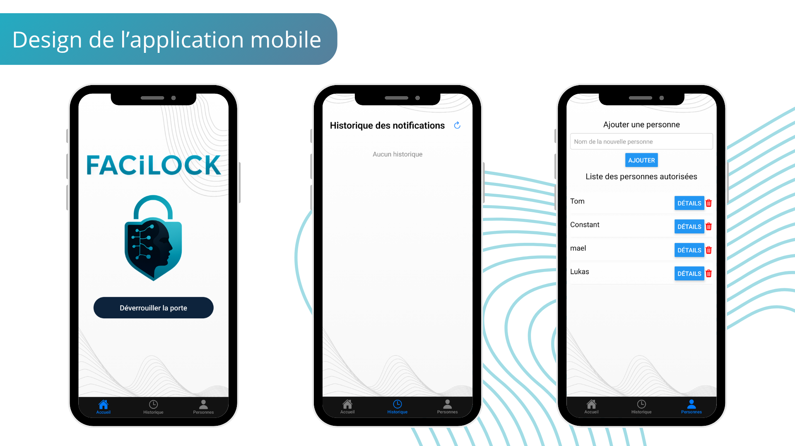

# FaciLock — Application mobile

Application React Native (Expo) pour piloter FaciLock à distance. Elle communique avec l'API Flask du [backend Raspberry Pi](../backend/raspberrypi/README.md).

<p align="center">
  
</p>

## Écrans

| Onglet | Fichier | Contenu |
|--------|---------|---------|
| Accueil | `app/(tabs)/index.tsx` | État du verrou en direct (SSE) et bouton de déverrouillage |
| Historique | `app/(tabs)/historique.tsx` | Vidéos des visiteurs inconnus, lecture et suppression |
| Autorisés | `app/(tabs)/authorized.tsx` | Liste des personnes autorisées : ajout, renommage, suppression, gestion des photos, capture depuis la caméra du Pi |

Au lancement, l'application enregistre son jeton de notification auprès du serveur (`/api/register_push_token`) pour recevoir les alertes « Visiteur inconnu ».

## Configuration

L'adresse du serveur et le jeton d'API sont définis en dur au début de chacun des trois fichiers d'onglets :

```ts
const BASE_URL = 'https://app.exemple.com'; // adresse du serveur Flask
const TOKEN = 'CHANGEME';                   // valeur de VIDEO_TOKEN dans app.py
```

## Installation

Prérequis : Node.js, et Android Studio ou Xcode pour compiler le client de développement (l'application utilise `expo-dev-client` et Firebase, elle ne fonctionne pas dans Expo Go).

```bash
cd mobile_app
npm install
npx expo run:android   # ou npx expo run:ios
```

Pour les lancements suivants :

```bash
npm start
```

## Stack

- Expo SDK 53, Expo Router
- axios pour les appels HTTP
- react-native-event-source pour l'état du verrou en direct
- Expo Notifications et Firebase Messaging pour les notifications push
- expo-av pour la lecture des vidéos
